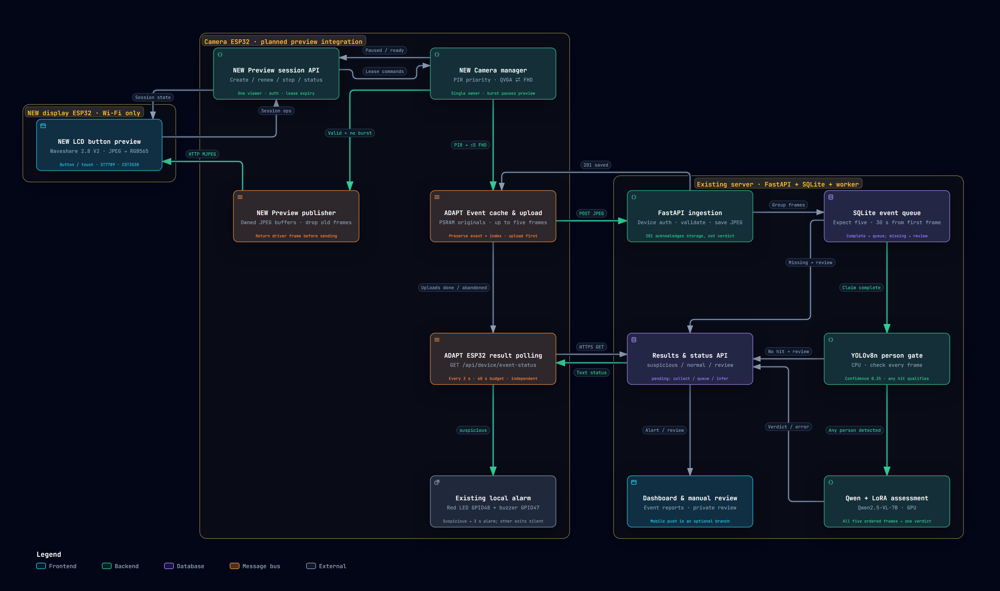
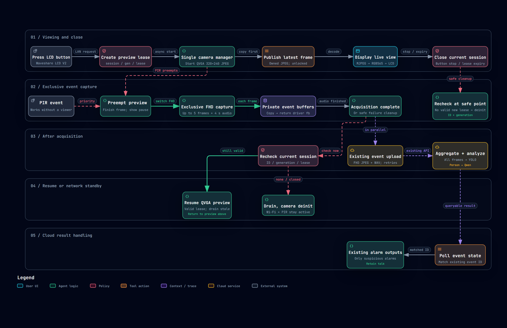

# ESP32 Camera, LCD Viewer & Monitoring Server

**English** | [简体中文](README.zh-CN.md)

A monitoring system built around two ESP32 boards and a Python server: a camera captures motion-triggered evidence, a touchscreen provides live viewing over the local network, and a web application manages devices, events, review and optional AI assessment.

[Features](#features) · [Hardware](#hardware-and-requirements) · [Architecture](#architecture) · [Startup](#startup) · [Daily use](#daily-use)

## Features

- **Motion-triggered evidence:** PIR events capture up to five 1920 × 1080 JPEGs and approximately four seconds of 16 kHz mono audio. A light sensor controls dark-scene illumination; uploads retain event and frame identifiers.
- **Local live view:** the LCD receives 320 × 240 MJPEG directly from the camera. Viewing uses an authenticated, renewable session. Event capture has priority and temporarily pauses preview.
- **Touchscreen setup:** independently configure Wi-Fi and camera pairing, save settings in NVS, view connection status and show a UTC+8 network-synchronized clock. USB serial provisioning is also available.
- **Web dashboard:** administrator and viewer accounts, device ownership, event history, images, recordings and manual review. Browser-to-camera talkback uses the camera speaker; event recordings provide the separate listening path.
- **Two assessment modes:** a CPU worker queues evidence for human review; an optional GPU worker uses YOLO person detection and Qwen2.5-VL-7B with a LoRA adapter for event assessment. The camera polls results and activates its sound/light alarm for `suspicious` events.
- **Optional family identity:** the identity firmware profile supports camera-side face enrollment, local template storage, revocation and V2 metadata uploads. Member management is available in the dashboard. Automatic family exemption is disabled by default.

## Hardware and requirements

The camera and display are **separate boards** connected over Wi-Fi. GPIO numbers below belong to their respective boards. Camera pin mapping and flash profiles are software configurations: confirm the actual board, sensor, memory and wiring before loading firmware.

| Component | Configured hardware / requirement |
| --- | --- |
| Camera controller | ESP32-S3 using the **ESP32-S3-EYE pin map**, with PSRAM; Arduino profiles select OPI PSRAM. A compatible camera sensor is required. OV5640-specific standby is used only when that sensor is detected. |
| Camera flash | Preview profile: default **4 MB** flash / 3 MB application. Identity profile: default **8 MB** / 6 MB application with a dedicated `face_store` partition. A 16 MB profile is available. Select the actual installed capacity; identity is not supported by the 4 MB profile. |
| Camera peripherals | PIR sensor, analog light sensor, white illumination, red alarm indicator, buzzer, **INMP441** microphone and **MAX98357** speaker amplifier. Use suitable power supplies, common ground and drivers for external loads. |
| LCD viewer | **Waveshare ESP32-S3-Touch-LCD-2.8 V2**: 2.8-inch ST7789 display, CST3530 capacitive touch, **16 MB flash + 8 MB PSRAM**. The 240 × 320 panel is used in **320 × 240 landscape**. V1 uses a different touch controller. [Board documentation](https://docs.waveshare.com/ESP32-S3-Touch-LCD-2.8) |
| Network | 2.4 GHz Wi-Fi. Camera and LCD need direct LAN reachability. The camera also needs a reachable **HTTPS** server endpoint and network time for TLS. |
| Web / CPU server | Python **3.12** is the reference development environment. Linux or WSL is required for the worker; Windows can run the web application and ingestion service. Storage must accommodate images, audio and SQLite databases. |
| Optional AI server | Linux, a compatible NVIDIA CUDA/PyTorch environment, enough GPU memory for the configured Qwen model, and local Qwen, LoRA and YOLO weights. Model weights and the GPU stack are not included. |
| Firmware tools | Arduino CLI or IDE with **Arduino-ESP32 3.3.12**; LCD uses pinned **LVGL 8.3.10**, RGB565. The LCD PowerShell builder also needs Python and native `g++` on PATH. |

<details>
<summary>Configured GPIO reference</summary>

| Camera function | GPIO / setting |
| --- | --- |
| Camera D0–D7 | `11, 9, 8, 10, 12, 18, 17, 16` |
| XCLK / SCCB SDA / SCCB SCL | `15` at 20 MHz / `4` / `5` |
| VSYNC / HREF / PCLK | `6` / `7` / `13`; PWDN and reset are `-1` |
| PIR / light ADC | `1` / `2`; calibrate the light threshold for the sensor |
| White light / red alarm / buzzer | `21` / `48` / `47`, active high |
| INMP441 BCLK / WS / DIN | `39` / `40` / `41`; I2S0, 3.3 V, left channel |
| MAX98357 BCLK / WS / DOUT | `14` / `38` / `42`; separate I2S1 clock domain |

| LCD function | GPIO / setting |
| --- | --- |
| Display MOSI / SCLK / CS / DC / reset | `45` / `40` / `42` / `41` / `39`; FSPI 40 MHz |
| Backlight | `5`, PWM |
| Touch SDA / SCL / reset / interrupt | `1` / `3` / `2` / `4`; I2C address `0x58` |
| BOOT / battery power hold | `0` / `7` |

The source references are [camera pins](firmware/camera/main/camera_pins.h), [camera settings](firmware/camera/main/project_settings.h) and [LCD board support](firmware/lcd_viewer/src/board/board_port.cpp). Matching GPIO numbers on the two boards do not imply a wired connection between them.

</details>

## Architecture

### Overall architecture

The diagrams below are exported directly from the existing root HTML files, preserving their colors, layout and visual style. **They retain an earlier design snapshot:** `NEW`, `ADAPT`, `Planned` and “not implemented” refer to that stage. Preview sessions, camera ownership management and the LCD are now implemented. The tables and explanations below describe current code; performance values in the original diagrams remain design targets.

[English HTML](esp32-lcd-overall-en.html) · [中文 HTML](esp32-lcd-overall-zh.html) · [Full-resolution image](docs/architecture/esp32-lcd-overall-en.png)



| Layer | Source | Responsibility |
| --- | --- | --- |
| Camera firmware | [firmware/camera](firmware/camera/README.md) | `main/main.cpp` initializes the device. The camera manager owns sensor access; other modules handle capture, preview, audio, uploads, identity and result polling. |
| LCD firmware | [firmware/lcd_viewer](firmware/lcd_viewer/README.md) | `lcd_viewer.ino` composes board drivers, LVGL UI, saved configuration, clock and preview networking. |
| Web application | [server/main.py](server/main.py) | FastAPI routes, device authentication, user sessions, owner-scoped data access, dashboard and ingestion. |
| Persistence and event queue | [server/store.py](server/store.py), [server/event_queue.py](server/event_queue.py) | Media files plus SQLite metadata, ordered frame aggregation, queue and result state. No Redis or Celery service is required. |
| Assessment and policy | [server/worker.py](server/worker.py), [server/alarm_policy.py](server/alarm_policy.py) | Human-review routing or model inference, actor association and event-level decisions. |
| Member lifecycle | [server/member_api.py](server/member_api.py), [server/device_commands.py](server/device_commands.py) | Enrollment/revocation requests, commands polled by cameras and acknowledgement of durable local changes. |

**Preview path.** The LCD creates a session on camera port 80 and reads MJPEG on port 81. Both use plain HTTP with the pairing token in a Bearer authorization header and are intended for a trusted LAN. One viewer is supported; the camera lease is 30 seconds and the LCD renews it every 10 seconds. Video stays on the LAN, so the server does not relay live preview.

**Event path.** A PIR event preempts preview and acquires up to five FHD images plus audio. Driver frames are copied to owned storage before network transfer. After acquisition, preview can resume if the current session is still valid; it does not wait for cloud inference. Upload acknowledgement means evidence was saved, not that assessment has finished. The server aggregates five frames by index; network arrival order may differ. Incomplete events expire to manual review when the collection window ends, by default 30 seconds from the first accepted frame (`EVENT_WAIT_SECONDS`). The worker processes complete events, and the camera separately polls the event result.

**Identity and ownership.** Camera upload credentials and LCD pairing credentials are independent. Administrators assign cameras to viewer accounts. With the identity profile, face templates remain on the camera; enrollment is complete only after durable storage and acknowledgement. An unknown identity alone is not an alarm, and a family match does not automatically exempt other people in a scene.

### Preview and event scheduling

[English HTML](lcd-capture-workflow-en.html) · [中文 HTML](lcd-capture-workflow-zh.html) · [Full-resolution image](docs/architecture/lcd-capture-workflow-en.png)



GitHub displays the PNG previews in this README. To use the HTML diagrams' zoom, search and route tools, open the corresponding file locally after cloning, or download the HTML file from GitHub and open it in a browser.

## Startup

Start the components in this order: **server and accounts → worker → camera configuration and firmware → LCD pairing → dashboard use**. The browser-only demo can be used before connecting hardware.

### 1. Get the project

```bash
git clone --branch server https://github.com/shell-bit/3070_ESP32_camera.git
cd 3070_ESP32_camera
```

If this checkout already exists, use its `server` branch. Commands below run from the repository root unless stated otherwise. Local credentials, media/databases, SDKs, model weights and generated firmware are not included in the repository.

### 2. Start the web application and CPU review worker

For a complete local workflow, run **both processes in Linux or WSL** using the same checkout, Python environment and absolute `CAMERA_DATA_DIR`. With WSL, prefer a checkout and virtual environment inside its Linux filesystem.

Terminal 1:

```bash
python3 -m venv .venv
.venv/bin/python -m pip install -r server/requirements-web.txt
export CAMERA_DATA_DIR="$PWD/server/ai-data"
export AUTH_ALLOW_HTTP=1
export AI_RUNTIME_MODE=cpu_review
.venv/bin/python server/manage_users.py bootstrap
.venv/bin/python -m uvicorn main:app --app-dir server --host 127.0.0.1 --port 8000
```

Terminal 2, from the **same repository root**:

```bash
export CAMERA_DATA_DIR="$PWD/server/ai-data"
.venv/bin/python server/worker.py --cpu-review
```

Open [http://127.0.0.1:8000/login](http://127.0.0.1:8000/login). The CPU worker retains evidence for manual review; it does not perform visual AI inference. `AI_RUNTIME_MODE` labels the web health response; `--cpu-review` selects the actual worker mode. Running the web service alone does not process complete queued events.

`AUTH_ALLOW_HTTP=1` is for this loopback browser demo. For real camera access, put the web application behind an HTTPS reverse proxy with a certificate trusted by the camera, make that endpoint reachable from the camera network, and unset `AUTH_ALLOW_HTTP` before restarting the web process. The camera cannot upload to the loopback HTTP demo URL.

The proxy must preserve the public `Host` and send `X-Forwarded-Proto: https`; configure Uvicorn to trust forwarded headers only from the proxy address. These values are needed for the browser's same-origin authentication checks.

<details>
<summary>Windows PowerShell: web interface and ingestion only</summary>

```powershell
python -m venv .venv
$projectPython = '.\.venv\Scripts\python.exe'
& $projectPython -m pip install -r server/requirements-web.txt
$env:CAMERA_DATA_DIR = Join-Path $PWD 'server/ai-data'
$env:AUTH_ALLOW_HTTP = '1'
& $projectPython server/manage_users.py bootstrap
& $projectPython -m uvicorn main:app --app-dir server --host 127.0.0.1 --port 8000
```

The worker uses the Unix `fcntl` module. For event processing, use the Linux/WSL setup above for both services; do not accidentally create separate data directories for the web application and worker.

</details>

### 3. Create users and register the camera

1. On an empty account database, `bootstrap` creates the administrator and writes initial credentials to **`$CAMERA_DATA_DIR/auth/initial-admin.txt`**. Read that file privately; it is not a repository file.
2. Sign in, open **Account** (`/account`), change the password, then remove the initial credential file. Re-running `bootstrap` does not reset an existing account.
3. In **Admin** (`/admin`), create a viewer account, register the exact camera device ID and assign the camera to that viewer.
4. Save the device token shown at assignment into the camera's local configuration. Assignment/reassignment rotates this token. Use the viewer account for that camera's dashboard and member management.

### 4. Configure and prepare the camera

The following firmware examples use **Windows PowerShell**, an installed `arduino-cli` on PATH and the pinned ESP32 core. Preserve an existing local configuration:

```powershell
if (-not (Test-Path 'firmware/camera/main/project_local.h')) {
    Copy-Item 'firmware/camera/main/project_local.example.h' 'firmware/camera/main/project_local.h'
}
```

Edit the ignored `project_local.h`:

| Setting | Value to provide |
| --- | --- |
| `PROJECT_WIFI_SSID`, `PROJECT_WIFI_PASSWORD` | Camera's 2.4 GHz network credentials |
| `PROJECT_DEVICE_ID`, `PROJECT_DEVICE_TOKEN` | Exact registered device ID and assigned upload token |
| `PROJECT_UPLOAD_URL` | `https://your-server.example/api/device/upload`; retain this suffix for both profiles, including identity/V2 |
| `PROJECT_PREVIEW_TOKEN` | An independent random token of 24–128 ASCII URL-safe characters; a 32-character random hexadecimal token is compatible. Use the same token on the LCD. |
| `PROJECT_DEEP_SLEEP` | Keep `0` for on-demand LAN preview |

Choose **one** build profile that matches the board's actual capacity:

```powershell
# Preview and event capture; default 4 MB profile
python firmware/camera/tools/build_arduino.py --cli arduino-cli --flash-size 4

# Alternative: identity, local face templates and V2 uploads; at least 8 MB flash
python firmware/camera/tools/prepare_face_models.py
python firmware/camera/tools/build_arduino.py --cli arduino-cli --identity --flash-size 8
```

Supply `--config-file <your-arduino-cli.yaml>` if the CLI uses a separate installed SDK configuration. On Windows, use a simple build path without `+` characters. The model preparation command downloads pinned public inputs. Identity enrollment also needs an initialized `face_store`; automatic formatting is disabled, so first-time storage provisioning must be handled deliberately without erasing existing templates.

Build outputs are in `firmware/camera/build-camera_preview/output/` or `firmware/camera/build-camera_identity/output/`. These commands build firmware only. Use a board-appropriate upload procedure after confirming the board, port and partition layout; do not assume a merged factory image preserves saved data. See the [camera guide](firmware/camera/README.md).

### 5. Prepare and pair the LCD

Prepare the pinned LCD dependency and build from PowerShell:

```powershell
python firmware/lcd_viewer/prepare_dependencies.py
& ./firmware/lcd_viewer/build.ps1 -ArduinoCli arduino-cli
```

Alternatively, open `firmware/lcd_viewer/lcd_viewer.ino` in Arduino IDE with its adjacent `src/` directory. Use `firmware` as the sketchbook, the prepared LVGL library, and **ESP32S3 Dev Module / 16 MB flash / OPI PSRAM / 16M Flash (3MB APP/9.9MB FATFS) / USB CDC On Boot Enabled**. See the [LCD guide](firmware/lcd_viewer/README.md) for the board-specific upload procedure and NVS preservation.

After installing the correct firmware:

1. On the LCD, open **Setup → Wi-Fi**, select or enter the network, then **Save & restart**. Wi-Fi alone enables connection information and the clock.
2. Open **Setup → Camera**, enter the camera's **LAN hostname or IPv4 address** and `PROJECT_PREVIEW_TOKEN`. In Advanced, use control port **80** and stream port **81**, then **Save & restart**.
3. Each page saves its own group and preserves the other. Preview becomes available when both groups are configured and the camera is reachable. The server URL and upload token are not the LCD pairing values.

USB setup is available at **115200 baud** using [setup.example.json](firmware/lcd_viewer/setup.example.json), sent as one newline-terminated JSON object. USB provisioning replaces the whole configuration; touchscreen saves update only their selected group.

<details>
<summary>Optional: enable the GPU assessment worker</summary>

Use an existing working Linux CUDA/PyTorch/Qwen environment with compatible Transformers and `qwen-vl-utils`. Ensure it also has the Web dependencies from `server/requirements-web.txt`, then install `server/requirements-worker.txt` without replacing its compatible Torch stack. The worker list supplements this environment; it is not a complete model installation.

Stop the CPU worker first. In the GPU environment, set the same absolute data directory used by the web application and paths to locally available model files:

```bash
export CAMERA_DATA_DIR="$PWD/server/ai-data"
export QWEN_MODEL_PATH="/path/to/Qwen2.5-VL-7B-Instruct"
export QWEN_LORA_PATH="/path/to/lora-adapter"
export YOLO_MODEL_PATH="/path/to/yolov8n.pt"
python server/worker.py
```

The LoRA directory must contain `adapter_config.json` and `adapter_model.safetensors`. Model loading is local; this command does not provision weights. Keep one worker per data directory. If setting the web health label, use `AI_RUNTIME_MODE=gpu_required` in the web process environment; that setting itself does not switch worker modes.

</details>

## Daily use

| Task | How to use it |
| --- | --- |
| View live video | Tap **Start preview** or briefly press LCD **BOOT**. A session lasts 60 seconds; **Continue 60s** restarts the countdown from that moment. Tap **Close** or press BOOT again to stop. |
| Understand a paused preview | PIR capture, enrollment or identity processing may pause video. Frames older than one second are marked stale; a valid session can resume after camera work completes. |
| Capture an event | Allow the PIR warm-up period of approximately 30 seconds after camera startup, then trigger motion. The camera captures, uploads and polls the event result independently of LCD viewing. |
| Review events | Sign in as the assigned viewer at `/`. Inspect events, images and recordings. CPU-mode events require a human decision. **Keep** requires a description; **Dismiss** deletes the retained review images; **Retry** requeues an eligible complete event. |
| Enroll a family member | With an online, assigned identity-enabled camera, open `/members`, add a member and start enrollment. Present one person with varied face angles; the device needs three consistent samples within 120 seconds. Wait for confirmed registration. |
| Use audio | Play event recordings in the dashboard. Talkback sends browser microphone audio to the camera speaker; it needs microphone permission, a secure browser context and an available camera. |
| Read clock / power state | The LCD shows UTC+8 after SNTP synchronization. With saved Wi-Fi and no active viewing/Setup, the backlight turns off 30 seconds after its wake/reset trigger; BOOT wakes it. Wi-Fi stays connected. |

Keep Wi-Fi credentials, pairing/upload tokens, initial admin credentials, SQLite databases, personal images/audio and local face templates outside Git. Optional mobile push additionally requires a configured Firebase project and a registered client; it is separate from basic monitoring.

**中文使用说明：** [切换到简体中文](README.zh-CN.md)
