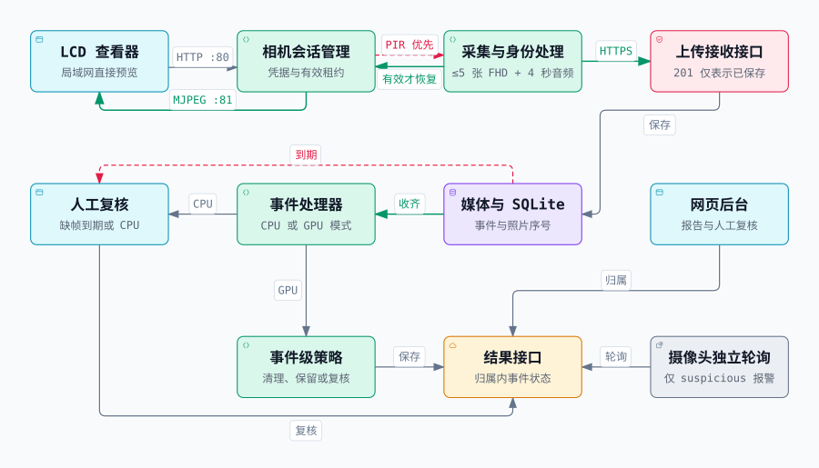

# ESP32 摄像头、LCD 查看器与监控服务器

[English](README.md) | **简体中文**

本项目由两块 ESP32 开发板和一个 Python 服务器组成：摄像头负责运动触发采集，触摸屏通过局域网查看实时画面，网页端负责设备管理、事件记录、人工复核和可选的 AI 分析。

[主要功能](#主要功能) · [硬件需求](#硬件参数与环境需求) · [项目架构](#项目架构) · [启动流程](#启动流程) · [日常使用](#日常使用)

## 主要功能

- **运动触发采集：** PIR 触发后采集最多 5 张 1920 × 1080 JPEG，以及约 4 秒的 16 kHz 单声道音频。通过光线传感器判断补光需求，上传时保留事件编号和照片顺序。
- **局域网实时预览：** LCD 直接接收摄像头的 320 × 240 MJPEG 视频。预览需要配对凭据和可续期会话；事件采集优先，会临时暂停预览。
- **触屏配置与时钟：** Wi-Fi 和摄像头设置可以独立保存到 NVS，支持连接状态查看、UTC+8 网络校时，以及 USB 串口配置。
- **网页监控后台：** 提供管理员与普通用户账户、设备归属管理、事件历史、图片、录音和人工复核。浏览器麦克风可向摄像头扬声器发送对讲音频；事件录音提供独立的收听功能。
- **两种事件处理模式：** CPU worker 将证据交给人工复核；可选 GPU worker 使用 YOLO 人体检测、Qwen2.5-VL-7B 与 LoRA 进行事件分析。摄像头轮询结果，仅在 `suspicious` 时启动声光报警。
- **可选家人身份功能：** 身份固件支持摄像头端人脸登记、模板持久化、撤销和 V2 元数据上传，网页端提供成员管理。默认关闭家人自动豁免。

## 硬件参数与环境需求

摄像头和显示屏是通过 Wi-Fi 连接的**两块独立开发板**，下列 GPIO 分别属于各自的板子。摄像头引脚映射和 Flash 档位是代码配置；烧录前需要核对实际板型、传感器、存储容量及接线。

| 组成部分 | 配置与需求 |
| --- | --- |
| 摄像头主控 | ESP32-S3，使用 **ESP32-S3-EYE 引脚映射**，需要 PSRAM；Arduino 构建默认选择 OPI PSRAM。摄像头传感器须与配置兼容，仅在检测到 OV5640 时使用其专用待机逻辑。 |
| 摄像头 Flash | 预览档默认 **4 MB** Flash / 3 MB 应用分区；身份档默认 **8 MB** / 6 MB 应用分区，另有 `face_store` 分区；支持 16 MB 档。必须按实际容量选择，4 MB 档不支持身份固件。 |
| 摄像头外围设备 | PIR 传感器、模拟光线传感器、白光补光、红色报警灯、蜂鸣器、**INMP441** 麦克风、**MAX98357** 功放及扬声器。外部负载需要合适的供电、共地和驱动电路。 |
| LCD 查看器 | **Waveshare ESP32-S3-Touch-LCD-2.8 V2**：2.8 英寸 ST7789 屏幕、CST3530 电容触控、**16 MB Flash + 8 MB PSRAM**。240 × 320 面板按 **320 × 240 横屏**使用。V1 的触控芯片不同。[官方硬件说明](https://docs.waveshare.com/ESP32-S3-Touch-LCD-2.8) |
| 网络 | 2.4 GHz Wi-Fi；摄像头与 LCD 在局域网内可以直接互访。摄像头还需要可访问的 **HTTPS** 服务地址及网络时间，以完成 TLS 连接。 |
| Web / CPU 服务器 | 开发参考环境为 Python **3.12**。worker 需要 Linux 或 WSL；Windows 可以运行网页与上传接收服务。磁盘需要容纳图片、录音和 SQLite 数据库。 |
| 可选 AI 服务器 | Linux、兼容的 NVIDIA CUDA/PyTorch 环境、足够运行所配置 Qwen 模型的显存，以及本地 Qwen、LoRA 和 YOLO 权重。仓库不包含权重或 GPU 软件环境。 |
| 固件开发工具 | Arduino CLI 或 IDE，使用 **Arduino-ESP32 3.3.12**；LCD 使用固定版本 **LVGL 8.3.10** 和 RGB565。LCD 的 PowerShell 构建脚本还需要 Python，以及 PATH 中的原生 `g++`。 |

<details>
<summary>展开查看当前 GPIO 配置</summary>

| 摄像头功能 | GPIO / 设置 |
| --- | --- |
| 摄像头 D0–D7 | `11, 9, 8, 10, 12, 18, 17, 16` |
| XCLK / SCCB SDA / SCCB SCL | `15`，20 MHz / `4` / `5` |
| VSYNC / HREF / PCLK | `6` / `7` / `13`；PWDN、reset 均为 `-1` |
| PIR / 光线 ADC | `1` / `2`；光线阈值需要按传感器校准 |
| 白色补光 / 红色报警灯 / 蜂鸣器 | `21` / `48` / `47`，高电平有效 |
| INMP441 BCLK / WS / DIN | `39` / `40` / `41`；I2S0、3.3 V、左声道 |
| MAX98357 BCLK / WS / DOUT | `14` / `38` / `42`；独立 I2S1 时钟 |

| LCD 功能 | GPIO / 设置 |
| --- | --- |
| 显示 MOSI / SCLK / CS / DC / reset | `45` / `40` / `42` / `41` / `39`；FSPI 40 MHz |
| 背光 | `5`，PWM |
| 触控 SDA / SCL / reset / interrupt | `1` / `3` / `2` / `4`；I2C 地址 `0x58` |
| BOOT / 电池供电保持 | `0` / `7` |

配置依据为[摄像头引脚](firmware/camera/main/camera_pins.h)、[摄像头设置](firmware/camera/main/project_settings.h)和 [LCD 板级驱动](firmware/lcd_viewer/src/board/board_port.cpp)。两块板上相同的 GPIO 编号不代表需要相互接线。

</details>

## 项目架构

下图将摄像头、LCD、服务器和浏览器整合在同一张架构图中，展示实时预览、事件采集、服务器处理和报警反馈的完整链路。

[交互 HTML](docs/architecture/system-zh.html) · [查看原尺寸 SVG](docs/architecture/system-zh.svg)

[](docs/architecture/system-zh.svg)

[LCD 查看器](firmware/lcd_viewer/README.md)通过摄像头的 80 端口建立认证会话，再从 81 端口直接接收 MJPEG。两条连接均在可信局域网内通过 HTTP 携带配对 token，服务器不承担实时视频中转。摄像头同一时间只接受一个查看会话，租约为 30 秒，LCD 每 10 秒续期。

PIR 触发采集时，[摄像头固件](firmware/camera/README.md)优先处理事件，将最多 5 张 FHD JPEG 复制到独立缓冲区，录制约 4 秒音频，再用独立的设备凭据通过 HTTPS 上传。采集及本地身份识别（如启用）结束后，若当前会话仍有效，预览即可恢复，无需等待服务器分析。使用身份固件时，人脸模板保存在摄像头本地，V2 上传包含身份元数据。上传成功仅表示证据已保存，不代表分析已经结束。

[服务器](server/main.py)保存媒体和 SQLite 状态，并按事件和照片编号聚合图片。收集窗口默认 30 秒，到期时缺图事件进入人工复核。独立的 [worker](server/worker.py) 在 CPU 模式下将完整事件交由人工复核，在 GPU 模式下使用 YOLO 和 Qwen 分析，再应用事件策略。家人豁免默认关闭；不确定或分析失败的情况需要复核。网页按设备归属限制访问，摄像头独立轮询结果，仅在收到 `suspicious` 时报警；轮询超时不代表正常。

点击架构图可放大查看。克隆后，用浏览器打开 HTML 可使用缩放、搜索和源码详情；页面默认浅色，保留主题与视觉风格切换按钮。

## 启动流程

推荐顺序：**启动服务器并建立账户 → 启动 worker → 配置摄像头与固件 → 配对 LCD → 使用网页后台**。尚未连接硬件时，可以先体验本机网页。

### 1. 获取项目

```bash
git clone --branch server https://github.com/shell-bit/3070_ESP32_camera.git
cd 3070_ESP32_camera
```

如果已经有本地仓库，使用其 `server` 分支即可。除特别说明外，以下命令均从仓库根目录执行。仓库不包含本地凭据、媒体/数据库、SDK、模型权重或生成的固件。

### 2. 启动网页与 CPU 人工复核 worker

要运行完整的本地流程，请把**网页与 worker 都放在 Linux 或 WSL 中**，使用同一份仓库、Python 环境和绝对路径 `CAMERA_DATA_DIR`。使用 WSL 时，建议将仓库和虚拟环境放在其 Linux 文件系统中。

终端 1：

```bash
python3 -m venv .venv
.venv/bin/python -m pip install -r server/requirements-web.txt
export CAMERA_DATA_DIR="$PWD/server/ai-data"
export AUTH_ALLOW_HTTP=1
export AI_RUNTIME_MODE=cpu_review
.venv/bin/python server/manage_users.py bootstrap
.venv/bin/python -m uvicorn main:app --app-dir server --host 127.0.0.1 --port 8000
```

在**同一仓库根目录**打开终端 2：

```bash
export CAMERA_DATA_DIR="$PWD/server/ai-data"
.venv/bin/python server/worker.py --cpu-review
```

访问 [http://127.0.0.1:8000/login](http://127.0.0.1:8000/login)。CPU worker 保留证据并交给人工判断，不执行视觉 AI 推理。`AI_RUNTIME_MODE` 只设置网页健康接口中的模式标记，实际 worker 模式由 `--cpu-review` 决定。仅启动网页服务不会处理完整的待分析事件。

`AUTH_ALLOW_HTTP=1` 仅用于上述本机浏览器演示。连接真实摄像头时，需要配置 HTTPS 反向代理和摄像头信任的证书，保证摄像头网络可访问该地址，并在重新启动 Web 进程前取消 `AUTH_ALLOW_HTTP` 设置。摄像头不能使用上述回环 HTTP 演示地址上传。

反向代理需保留外部 `Host` 并传递 `X-Forwarded-Proto: https`，同时让 Uvicorn 仅信任该代理地址提供的转发头。这些信息用于浏览器登录及操作时的同源校验。

<details>
<summary>Windows PowerShell：仅启动网页与上传接收服务</summary>

```powershell
python -m venv .venv
$projectPython = '.\.venv\Scripts\python.exe'
& $projectPython -m pip install -r server/requirements-web.txt
$env:CAMERA_DATA_DIR = Join-Path $PWD 'server/ai-data'
$env:AUTH_ALLOW_HTTP = '1'
& $projectPython server/manage_users.py bootstrap
& $projectPython -m uvicorn main:app --app-dir server --host 127.0.0.1 --port 8000
```

worker 使用 Unix 的 `fcntl` 模块。需要处理事件时，按前面的 Linux/WSL 步骤运行两个服务，并确保它们使用同一个数据目录。

</details>

### 3. 建立账户并注册摄像头

1. 当账户数据库为空时，`bootstrap` 创建管理员，并将初始凭据写入 **`$CAMERA_DATA_DIR/auth/initial-admin.txt`**。在本机私下查看此文件，不要加入仓库。
2. 登录后进入 **Account**（`/account`）修改密码，然后移除初始凭据文件。再次运行 `bootstrap` 不会重置已有账户。
3. 在 **Admin**（`/admin`）创建普通用户，注册摄像头的准确设备 ID，并将设备分配给该用户。
4. 将分配时显示的设备 token 保存到摄像头本地配置；分配或重新分配设备会更换此 token。之后使用该普通用户查看设备后台和管理成员。

### 4. 配置并准备摄像头

以下固件示例使用 **Windows PowerShell**，假设已安装 `arduino-cli`、加入 PATH，并准备好固定版本的 ESP32 core。先创建本地配置，保留已有文件：

```powershell
if (-not (Test-Path 'firmware/camera/main/project_local.h')) {
    Copy-Item 'firmware/camera/main/project_local.example.h' 'firmware/camera/main/project_local.h'
}
```

编辑被 Git 忽略的 `project_local.h`：

| 设置 | 应填写的内容 |
| --- | --- |
| `PROJECT_WIFI_SSID`、`PROJECT_WIFI_PASSWORD` | 摄像头连接的 2.4 GHz 网络凭据 |
| `PROJECT_DEVICE_ID`、`PROJECT_DEVICE_TOKEN` | 已注册的准确设备 ID，以及分配时获得的上传 token |
| `PROJECT_UPLOAD_URL` | `https://your-server.example/api/device/upload`；两种固件都保留该后缀，身份/V2 版本也一样 |
| `PROJECT_PREVIEW_TOKEN` | 独立生成 24–128 个 ASCII URL 安全字符的随机 token，例如 32 位随机十六进制字符串；LCD 填写相同值 |
| `PROJECT_DEEP_SLEEP` | 使用局域网按需预览时保持为 `0` |

根据实际硬件容量，**选择一种**构建方式：

```powershell
# Preview and event capture; default 4 MB profile
python firmware/camera/tools/build_arduino.py --cli arduino-cli --flash-size 4

# Alternative: identity, local face templates and V2 uploads; at least 8 MB flash
python firmware/camera/tools/prepare_face_models.py
python firmware/camera/tools/build_arduino.py --cli arduino-cli --identity --flash-size 8
```

如果 CLI 使用独立的 SDK 配置，可追加 `--config-file <your-arduino-cli.yaml>`。Windows 构建目录应避免包含 `+` 字符。模型准备命令会下载固定版本的公开依赖。身份登记还需要已初始化的 `face_store`；默认不自动格式化，首次存储初始化需单独处理，避免清除已有模板。

生成文件分别位于 `firmware/camera/build-camera_preview/output/` 或 `firmware/camera/build-camera_identity/output/`。这些命令只构建固件。实际烧录前核对板型、串口和分区布局，使用对应板子的上传流程；合并工厂镜像不保证保留已保存的数据。详见[摄像头说明](firmware/camera/README.md)。

### 5. 准备并配对 LCD

在 PowerShell 中准备固定版本依赖并构建：

```powershell
python firmware/lcd_viewer/prepare_dependencies.py
& ./firmware/lcd_viewer/build.ps1 -ArduinoCli arduino-cli
```

也可以在 Arduino IDE 打开 `firmware/lcd_viewer/lcd_viewer.ino`，保留相邻的 `src/` 目录。将 `firmware` 设为 Sketchbook，使用准备好的 LVGL 库，选择 **ESP32S3 Dev Module / 16 MB Flash / OPI PSRAM / 16M Flash (3MB APP/9.9MB FATFS) / USB CDC On Boot Enabled**。具体板级上传流程及 NVS 保留方式见 [LCD 说明](firmware/lcd_viewer/README.md)。

安装对应固件后：

1. 在 LCD 打开 **Setup → Wi-Fi**，选择或填写网络，然后点击 **Save & restart**。仅配置 Wi-Fi 就能使用连接信息和时钟。
2. 打开 **Setup → Camera**，填写摄像头的**局域网主机名或 IPv4 地址**及 `PROJECT_PREVIEW_TOKEN`。Advanced 中控制端口为 **80**，视频端口为 **81**，然后 **Save & restart**。
3. 每个页面独立保存自己的配置组并保留另一组。两组都配置完成且摄像头可达后，即可预览。这里使用的不是服务器公网地址或上传 token。

也可使用 **115200 波特率**的 USB 串口配置，参考 [setup.example.json](firmware/lcd_viewer/setup.example.json)，发送一行以换行结束的 JSON。USB 配置会替换完整设置；触屏保存只更新当前配置组。

<details>
<summary>可选：启用 GPU 事件分析</summary>

使用已有可运行的 Linux CUDA/PyTorch/Qwen 环境，包含兼容的 Transformers 和 `qwen-vl-utils`。确认该环境也具备 `server/requirements-web.txt` 中的 Web 依赖，再安装 `server/requirements-worker.txt`，不替换其兼容的 Torch 软件栈。worker 清单用于补充现有环境，不是完整的模型安装方案。

先停止 CPU worker。在 GPU 环境中，设置与 Web 服务相同的绝对数据目录，以及已经存在的模型路径：

```bash
export CAMERA_DATA_DIR="$PWD/server/ai-data"
export QWEN_MODEL_PATH="/path/to/Qwen2.5-VL-7B-Instruct"
export QWEN_LORA_PATH="/path/to/lora-adapter"
export YOLO_MODEL_PATH="/path/to/yolov8n.pt"
python server/worker.py
```

LoRA 目录必须包含 `adapter_config.json` 和 `adapter_model.safetensors`。模型从本地加载，启动命令不会代为下载权重。每个数据目录只运行一个 worker。若需要调整网页健康接口的模式标记，在 Web 进程环境中设置 `AI_RUNTIME_MODE=gpu_required`；这个环境变量本身不会切换 worker 模式。

</details>

## 日常使用

| 目标 | 操作方法 |
| --- | --- |
| 查看实时画面 | 点击 **Start preview** 或短按 LCD **BOOT**。每次查看持续 60 秒，**Continue 60s** 从按下时重新计时；点击 **Close** 或再按 BOOT 停止。 |
| 理解预览暂停 | PIR 采集、成员登记和身份处理可能暂停视频；超过 1 秒没有成功解码新帧时，当前显示的画面会标为过期。相关任务完成后，有效会话可以恢复。 |
| 触发事件采集 | 摄像头启动后等待约 30 秒 PIR 预热，再触发运动。采集、上传和结果轮询不依赖 LCD 是否正在查看。 |
| 查看与复核事件 | 用设备所属普通用户登录 `/`，查看事件、图片和录音。CPU 模式需要人工判断；**Keep** 需填写描述，**Dismiss** 删除该复核项保留的图片，**Retry** 将满足条件的完整事件重新入队。 |
| 登记家人 | 使用已分配、在线且启用身份功能的摄像头，在 `/members` 添加成员并开始登记。一次只让一人面对摄像头并适当变化角度，设备需在 120 秒内采集 3 个一致样本；等待登记确认。 |
| 使用音频 | 在后台播放事件录音；对讲功能把浏览器麦克风音频发送到摄像头扬声器，需要麦克风权限、安全的浏览器环境，以及可用的摄像头。 |
| 时钟与背光 | SNTP 校时后显示 UTC+8。已有 Wi-Fi 配置且未预览/进入 Setup 时，背光在唤醒或计时重置后 30 秒关闭，可用 BOOT 唤醒；Wi-Fi 仍保持连接。 |

Wi-Fi 密码、配对/上传 token、初始管理员凭据、SQLite 数据库、个人图片/音频及本地人脸模板均应保留在 Git 之外。手机推送还需要独立配置 Firebase 项目并注册客户端，不属于基础监控启动的必需项。

**English guide:** [Switch to English](README.md)
